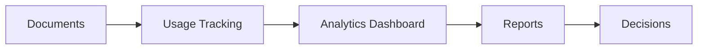

## Overview

Idealsync empowers you to transform your project documentation into a dynamic workspace. Turn ideas into actionable documents, streamline operations, automate repetitive tasks, gain insights from your data, and foster seamless team collaboration. With less busywork and more momentum, you organize knowledge effectively across your projects.

<Columns cols={2}>
  <Card title="Launching Ideas" icon="lightbulb" href="#launching-ideas">
    Capture and convert ideas into structured documentation quickly.
  </Card>
  <Card title="Operations Management" icon="settings" href="#operations">
    Connect workflows and manage documentation operations centrally.
  </Card>
  <Card title="Automations Setup" icon="zap" href="#automations">
    Build automations to eliminate manual updates and repetitions.
  </Card>
  <Card title="Data Insights" icon="bar-chart-3" href="#insights">
    Leverage analytics to inform decisions with document usage data.
  </Card>
  <Card title="Team Collaboration" icon="users" href="#collaboration">
    Enable real-time collaboration and knowledge sharing.
  </Card>
</Columns>

<Callout kind="info">
  Start with the [quickstart](/quickstart) to set up your first project space.
</Callout>

## Launching Ideas

Quickly turn concepts into polished documentation. Idealsync's launching feature lets you create pages from templates, import notes, or start from scratch.

<Steps>
  <Step title="Create New Page" icon="plus">
    Navigate to your workspace and select "New Page". Choose a template like "Idea Capture" or "Project Brief".
  </Step>
  <Step title="Add Content" icon="edit-3">
    Use the rich editor to outline your idea. Add sections for goals, tasks, and timelines.
  </Step>
  <Step title="Publish" icon="eye">
    Preview and publish. Share the live link with your team instantly.
  </Step>
</Steps>

## Operations Management

Manage day-to-day documentation operations with connected tools. Organize pages into folders, set permissions, and track versions.

<Tabs>
  <Tab title="Folder Structure" icon="folder">
    Create nested folders for projects.

    ```
    /projects
      /q1-roadmap
        goals.mdx
        tasks.mdx
      /q2-planning
    ```
  </Tab>
  <Tab title="Permissions" icon="shield">
    Assign roles like editor or viewer per page or folder.
  </Tab>
</Tabs>

## Automations Setup

Automate updates, notifications, and integrations to save time. Connect to external services via webhooks or API.

<CodeGroup tabs="JavaScript,Python">
  ```javascript
  // Set up webhook for page updates
  const webhookUrl = 'https://api.idealsync.com/webhooks/updates';
  fetch(webhookUrl, {
    method: 'POST',
    headers: { 'Authorization': 'Bearer YOUR_TOKEN' },
    body: JSON.stringify({ event: 'page.updated', pageId: '123' })
  });
  ```
  ```python
  import requests

  webhook_url = 'https://api.idealsync.com/webhooks/updates'
  headers = {'Authorization': 'Bearer YOUR_TOKEN'}
  data = {'event': 'page.updated', 'pageId': '123'}
  requests.post(webhook_url, json=data, headers=headers)
  ```
</CodeGroup>

<Callout kind="tip">
  Replace `YOUR_TOKEN` with your actual API token from settings.
</Callout>

## Data Insights

Gain actionable insights from your documentation usage. Track views, edits, and popular pages.



Use the dashboard at `https://dashboard.idealsync.com/analytics` to view metrics.

## Team Collaboration

Collaborate in real-time with comments, mentions, and version history.

<ExpandableGroup>
  <Expandable title="Real-time Editing" default-open="true">
    Multiple users edit simultaneously. Changes appear instantly.
  </Expandable>
  <Expandable title="Comments & Mentions">
    Add `@username` to notify team members. Resolve threads as tasks complete.
  </Expandable>
  <Expandable title="Version History">
    Revert to previous versions or compare changes side-by-side.
  </Expandable>
</ExpandableGroup>

## Next Steps

<Columns cols={2}>
  <Card title="Quickstart" icon="book-open" href="/quickstart" horizontal>
    Set up your first workspace.
  </Card>
  <Card title="API Reference" icon="code" href="/authentication" horizontal>
    Integrate programmatically.
  </Card>
</Columns>